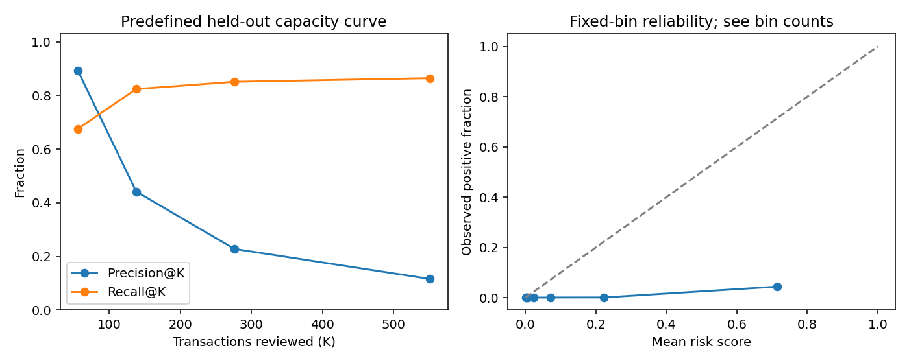

# Fraud Risk Scoring and Alert Prioritization

# Rares Constantinescu

A reproducible Python benchmark for scoring anonymized credit-card transactions and allocating
a fixed investigation budget. It compares classifiers on the historical ULB dataset, freezes
model and policy choices before held-out evaluation, and exposes deterministic Top-K ranking
through a Python API and CLI.

## Dataset and scope

Use the original [MLG-ULB Credit Card Fraud Detection dataset on Kaggle](https://www.kaggle.com/datasets/mlg-ulb/creditcardfraud):
284,807 transactions, 492 fraud labels, approximately two days in September 2013. Inputs are
anonymized PCA components `V1`–`V28`, `Amount`, and elapsed `Time`; target `Class` is binary.
No customer IDs, merchant information, geography or account histories are reconstructed.

Download `creditcard.csv` through Kaggle's normal access process, review its current terms,
and place it at **`data/raw/creditcard.csv`**. The raw data are ignored by Git and excluded
from source/wheel distributions. No dataset download, credentials or real-data file is needed
for tests. Published results contain aggregate metrics, not original transaction records.

The supplied local file matches the published shape/class counts and contains no missing or
non-finite cells. Its recorded checksum identifies that file, not authenticated upstream
provenance. Exact duplicate removal leaves 283,726 rows and 473 positives. Repeated identical
model inputs at different times are grouped to prevent partition contamination.

This is a historical anonymized benchmark, without evidence of modern banking effectiveness.
Upstream PCA preprocessing, card relationships and fraud-label delays cannot be audited.
The [technical report](docs/REAL_DATA.md) specifies the protocol, data audit and limitations.

## Evaluation protocol

**Primary: chronological.** Split deduplicated rows at 60%/80% time quantiles, keeping equal
timestamps together. Purge feature signatures already seen in an earlier partition:

| Partition | Before signature purge | Purged | Retained | Retained fraud labels |
| --- | ---: | ---: | ---: | ---: |
| Train | 170,236 | 0 | 170,236 | 342 |
| Validation | 56,746 | 561 | 56,185 | 57 |
| Final test | 56,744 | 1,720 | 55,024 | 74 |
| Total | 283,726 | 2,281 | 281,445 | 473 |

Complete accounting: **284,807 raw = 1,081 exact duplicates + 2,281 later-partition
signature repeats + 281,445 retained rows**. Exact duplicates include 19 fraud labels;
all 2,281 additional purged rows happen to be genuine. Purging ignores labels, retains each
signature in its earliest time partition, and does not delete any signature entirely.
There is no other row filtering. Test metrics describe signatures absent from earlier
partitions, rather than the entire unfiltered transaction stream. The [technical report](docs/REAL_DATA.md)
provides class counts at every stage and a verification command for the frozen membership.

**Secondary: stratified group-random.** Split unique model-input signatures with stratification,
retaining each signature in one partition. This conventional random comparison mixes times;
it does not replace the primary prospective ordering. Both protocols were fixed before
either final test was scored.

Four fixed candidates share train-fitted median imputation and scaling: prior-only dummy,
logistic regression, balanced logistic regression, and histogram gradient boosting. No
resampling or grid search is used. `Time` controls partitioning and is explicitly excluded
from model features. Model selection maximizes validation average precision (AP).

Validation also selects decision thresholds and the investigation-capacity fraction.
`selection.json`, fitted models, data checksum and partition membership are saved before
test scoring. The model is not refitted after selection. Evaluation verifies artifact/data
checksums and membership and accepts no new tuning settings.

## Measured results

The chronological test has **55,024 rows and 74 fraud labels (0.1345%)**. Validation selected
balanced logistic regression. Its test **AP is 0.7460** (dummy: 0.001345), ROC-AUC **0.9816**.

| Requested review fraction | Reviewed (K) | Frauds captured | False positives | Precision@K | Recall@K |
| --- | ---: | ---: | ---: | ---: | ---: |
| 0.10% | 56 | 50 / 74 | 6 | 89.29% | 67.57% |
| 0.25% | 138 | 61 / 74 | 77 | 44.20% | 82.43% |
| **0.50% — selected on validation** | **276** | **63 / 74** | **213** | **22.83%** | **85.14%** |
| 1.00% | 551 | 64 / 74 | 487 | 11.62% | 86.49% |

The validation-selected F1 threshold flags 52 rows: precision 94.23%, recall 66.22%, F1 0.7778.
This illustrates a different workload/capture tradeoff from Top-K. The conditional 95% group-
bootstrap interval is **[0.6286, 0.8392] for AP** and **[0.7534, 0.9311] for selected-capacity recall**.
Only 74 test positives and 200 bootstrap replicates underpin these approximate intervals.

The separate group-random experiment selects histogram gradient boosting: test AP **0.7709**,
with 79/95 frauds captured among 284 reviews at the validation-selected 0.5% fraction. Cohorts,
prevalence and selected models differ; these numbers do not isolate a temporal-split effect.

**Calibration limitation:** the primary model's mean test score is 7.46% versus 0.1345% observed
prevalence. It supports risk ordering, not calibrated probabilities or expected monetary loss.
Balanced class weights change the training objective and score scale; they do not estimate the
natural fraud prevalence. CLI outputs named `fraud_score` must not be read as event probabilities.
The report also discloses unusually strong shuffled-label controls and their validation-only
investigation; they are not presented as proof against leakage.



All candidate comparisons, threshold results, uncertainty, error slices and controls are in the
[technical report](docs/REAL_DATA.md), with full [chronological JSON](docs/results/creditcard_chronological.json)
and [group-random JSON](docs/results/creditcard_group_random.json). No predictive settings were
changed after either held-out result.

## Alert prioritization

`prioritize(scores, capacity, row_ids)` selects the highest scores without labels. Ties use
ascending source row ID; prediction batches use zero-based input row positions. Capacity must
be an integer between zero and batch size. The ranking core uses a bounded heap, with
O(n log K) time and O(K) space; input/ID validation also uses O(n) space. Selecting all rows
uses a full sort.

Predefined review fractions are **0.1%, 0.25%, 0.5%, 1%** of each retrospective evaluation
batch. Review count is `ceil(fraction × batch_size)`. Validation chooses the fraction with
minimum illustrative error cost. Test curves report all predefined capacities without
selecting a new winner. Metrics include reviewed rows, frauds captured, false positives,
precision@K and recall@K; fraud capture rate is another name for recall@K here.

Threshold policies maximize validation F1, minimize illustrative error cost, maximize recall
under a 0.5% alert budget, or maximize precision subject to 80% recall. Thresholds include
whole score ties; Top-K can split a score tie using the declared row-ID rule.

Costs default to **FN=100, FP=1 arbitrary units per error**. They are configurable assumptions,
not bank measurements or money saved. Amount is never treated as recoverable fraud loss.
Capacity limits apply to a complete batch, not a real-time daily investigation service.

## Installation

Use Python **3.10–3.12** and a virtual environment:

```bash
python3 -m venv .venv
source .venv/bin/activate
python -m pip install -r requirements.lock
python -m pip install --no-deps --no-build-isolation -e .
python -m pip check
```

Dependencies are version-pinned; package hashes and cross-platform bitwise reproducibility
are not guaranteed. Only load trusted local joblib models: deserialization can execute code.
Bundles retain feature order, preprocessing, dataset kind, thresholds and core dependency versions.

## Train and evaluate

After obtaining the data, use fresh output paths:

```bash
fraud-benchmark train --data data/raw/creditcard.csv --protocol chronological \
  --seed 2026 --output artifacts/ulb-chronological-2026
fraud-benchmark evaluate --data data/raw/creditcard.csv \
  --run artifacts/ulb-chronological-2026 --output artifacts/ulb-chronological-evaluation

fraud-benchmark train --data data/raw/creditcard.csv --protocol group_random \
  --seed 2026 --output artifacts/ulb-group_random-2026
fraud-benchmark evaluate --data data/raw/creditcard.csv \
  --run artifacts/ulb-group_random-2026 --output artifacts/ulb-group-random-evaluation
```

Each protocol performs four candidate fits, two 80%-training-group stability fits and one
shuffled-label control, with numerical thread pools limited to one thread. There is no
unbounded search. Training writes validation comparisons, frozen decisions, model/dummy
artifacts, membership and manifests. Evaluation writes JSON/Markdown reports, PR/confusion
and capacity/reliability figures, and local test scores. Existing outputs are preserved;
caught failures clean temporary work. Generated artifacts stay under ignored `artifacts/`.

Validation diagnostics include two fixed training-subset seeds, early/later time windows,
1% missing-cell perturbation and a shuffled-label control. Test uncertainty uses 200
signature-group bootstrap replicates, conditional on the frozen model/policies. Reliability
bins accompany Brier/log loss; these scores alone do not establish probability calibration.

## Prediction and investigation

```bash
fraud-benchmark predict --model artifacts/ulb-chronological-2026/model.joblib \
  --input examples/creditcard_request.json --output artifacts/scores.json
fraud-benchmark prioritize --input artifacts/scores.json --capacity 1 \
  --output artifacts/alerts.json
```

Prediction accepts a JSON array with exactly `Time`, `V1`–`V28`, and `Amount` in each row.
Feature order is normalized; `Class` and unexpected keys are rejected. Numeric missing cells
may be `null` and are imputed using training medians. Invalid types, infinities and negative
Time/Amount fail clearly. Scores are risk rankings, not established calibrated fraud probabilities.
The example is a hand-written schema illustration, not a copied transaction or efficacy evidence.
The original PCA transform is unavailable: the interface requires compatible transformed inputs
and cannot convert arbitrary raw banking records into those coordinates.

Prediction returns `row`, `fraud_score`, `flagged` and `threshold`. Prioritization returns ranked
selected rows independently of the threshold flag. Errors return CLI status 2. CSV, prediction
and ranking publication preserve existing files, including symlinks.

```python
from fraud_benchmark.prioritization import prioritize

alerts = prioritize([0.8, 0.9, 0.9], capacity=2, row_ids=[50, 30, 10])
assert [row["row"] for row in alerts] == [10, 30]
```

## Architecture and verification

The existing package is extended rather than replaced. Shared `schema.py`, `models.py`,
`evaluation.py`, `artifacts.py` and `cli.py` serve both dataset kinds. `credit_data.py` handles
the external-data audit and partitions; `credit_experiment.py` separates frozen training and
evaluation; `prioritization.py` handles capacity allocation; `diagnostics.py` and
`credit_reporting.py` provide uncertainty, reliability and aggregate reports.

```bash
python -m pytest -q
ruff check src tests scripts
ruff format --check src tests scripts
python -m build --no-isolation
python scripts/smoke_creditcard.py --output artifacts/software-smoke
python scripts/verify_data_accounting.py --data data/raw/creditcard.csv \
  --run artifacts/ulb-chronological-2026
```

Verified on Python 3.10.12: **106 tests passed without warnings**, both in the workspace and
from the unpacked source archive against the installed wheel. Both offline smoke workflows
passed without the real CSV. Lint, formatting, dependency consistency and distribution builds
passed. The version 0.2 synthetic model still loads and reproduces its example scores.
Python 3.12 and hosted Actions are configured but were not executed locally.

Tests use small generated software fixtures and temporary paths, with no external-data access.
They cover schema validation, duplicate/group/time isolation, train-only preprocessing, model
and threshold selection, label-free ranking, capacity ties/failures, hand-calculated metrics,
group-bootstrap equivalence, serialization, tampering, inference consistency and output preservation.
GitHub Actions targets Python 3.10/3.12, builds distributions, installs the wheel, and runs both
synthetic and real-schema fixture smoke workflows outside the checkout.

## Historical work and limitations

The original `generate_data.py`, `split_data.py`, `EDA.py`, CSVs, PDF and reports remain
unchanged. The earlier [synthetic benchmark](docs/SYNTHETIC_BENCHMARK.md), [data card](docs/DATA_CARD.md)
and [coursework audit](docs/AUDIT.md) remain accessible. Its invented relationships and scores
are background, not evidence for real-data effectiveness. `fraud-benchmark run` still runs
that simulation; `scripts/audit_original.py` audits the original coursework safely.

Only two historical days and 492 original fraud examples are available. Exact-input groups
cannot reveal unknown card dependence. Validation jointly selects models and policies, and
its 57 chronological positives give noisy estimates. Bootstrap intervals exclude training,
selection and future-distribution uncertainty. Relative-time ordering assumes prior labels
are available; real label delays, interventions, review outcomes and deployment are absent.
These constraints limit conclusions to the documented historical benchmark.
