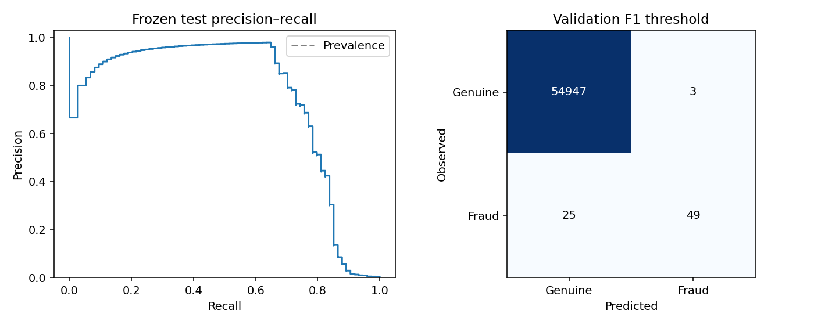

# ULB fraud risk scoring and alert prioritization

## Protocol fixed before held-out scoring

The local input `data/raw/creditcard.csv` matches the original ULB benchmark's published
shape and class counts: 284,807 rows, 492 positives, `Time`, `Amount`, `V1`–`V28`, and `Class`.
Its byte SHA-256 is `33a178be65174943a07d1736acf5898f6c8e1fa80950dbbe598c17eda968ec59`.
This identifies the supplied local file; it is not an authenticated upstream checksum.
There are no missing/non-finite values. The original CSV stays local, ignored, unchanged,
and excluded from package distributions. No transaction rows are included in published examples.

Source: [MLG-ULB on Kaggle](https://www.kaggle.com/datasets/mlg-ulb/creditcardfraud).
Kaggle's dynamically rendered card was not readable through the documentation browser, so
no redistribution license is asserted here. Obtain the original CSV through Kaggle's normal
access process and review its current terms. No authentication or access restriction was bypassed.

`Time` is nondecreasing and spans 0–172,792 seconds. Use it only for ordering, not as a model
feature. No customer, merchant, geographical or historical-account features are invented.
The provided PCA transformation cannot be audited or refitted on train-only raw features;
this upstream limitation applies to both protocols.

- Remove 1,081 exact full-row duplicates, retaining first occurrences: 283,726 rows and 473 positives.
- Group identical **model inputs** (`V1`–`V28`, `Amount`), excluding `Time` and label. There are
  275,663 unique signatures, including 8,063 repeat occurrences after full-row deduplication.
  Signatures are a conservative contamination guard, not reconstructed card identities.
  Conflicting labels for identical model inputs cause an error.
- Primary protocol: chronological 60/20/20 quantiles of deduplicated rows. Keep equal times
  together. Cutoffs are 120,393 and 145,234 seconds. Purge later-partition signatures observed
  in an earlier partition. Preserve chronological order within each partition.
- This gives train 170,236 rows / 342 positives, validation 56,185 / 57, test 55,024 / 74.
  The purge removes 561 validation and 1,720 test rows; no additional positives are removed.
- Secondary protocol: seeded stratified random split of unique signature groups, with all
  observations of a signature in one partition. This prevents exact-input contamination but
  mixes transaction times; it answers a different, less prospective question.

### Complete chronological data accounting

| Stage | Rows | Genuine | Fraud |
| --- | ---: | ---: | ---: |
| Raw source | 284,807 | 284,315 | 492 |
| Exact full-row duplicates removed | 1,081 | 1,062 | 19 |
| After exact deduplication | 283,726 | 283,253 | 473 |
| Initial training window | 170,236 | 169,894 | 342 |
| Initial validation window | 56,746 | 56,689 | 57 |
| Initial test window | 56,744 | 56,670 | 74 |
| Validation signature repeats purged | 561 | 561 | 0 |
| Test signature repeats purged | 1,720 | 1,720 | 0 |
| Final training partition | 170,236 | 169,894 | 342 |
| Final validation partition | 56,185 | 56,128 | 57 |
| Final test partition | 55,024 | 54,950 | 74 |
| Final partitions combined | 281,445 | 280,972 | 473 |

Thus **284,807 = 1,081 + 561 + 1,720 + 281,445**. The initial windows contain all
283,726 deduplicated rows; no missing-value, amount, class or other row filter is applied.
Every purged row has a model-input signature witnessed in an earlier time partition.
Of the 1,720 test removals, 253 repeat training only, 1,072 repeat the initial validation
window only, and 395 repeat both. Using the initial validation window for this check is
intentional: any validation signature already purged must also occur in training.

Purging is independent of labels; the fact that these 2,281 rows are all genuine is a property
of this input, not a filtering rule. All 473 deduplicated fraud rows and all 275,663 distinct
model-input signatures remain represented. Retained and purged source row IDs are disjoint
and together cover the deduplicated input exactly. Raw rows remain unchanged on disk.

This conservative group separation changes the evaluation population: the chronological
test estimates performance on later transactions whose signatures were absent from both
earlier partitions. It is not an estimate over all 56,744 rows in the initial test window or
the full operational stream. Repeated signatures within their earliest partition remain.
The previously summarized counts omitted the purge stage; frozen memberships and metrics
were correct. No split, model or policy change was needed. Re-evaluating both frozen models
reproduces every field in their published aggregate reports.

Fixed candidates: prior-only dummy, logistic regression (`C=1`), balanced logistic regression
(`C=1`, inverse-frequency class weights), and histogram gradient boosting (100 iterations,
15 leaves, minimum leaf 30, learning rate .08, L2=5, no early stopping). All use train-fitted
numeric median imputation and scaling; no resampling is applied. The 29 modeled inputs are
the supplied PCA components and Amount. Time is accepted/validated but explicitly dropped.

Select maximum validation non-interpolated average precision (AP). Select F1, illustrative
cost, capacity-constrained threshold and high-recall threshold on validation only. Predefine
batch review fractions **0.1%, 0.25%, 0.5%, 1%**; choose the capacity fraction with minimum
illustrative validation cost. Equal costs prefer fewer reviews. Review count is `ceil(rate × n)`.
Costs are FN=100 and FP=1 arbitrary units per error, never monetary loss or recoverable Amount.
Capacity policies rank by score descending, then original source row position ascending.
They use no labels at allocation time and apply to a complete retrospective batch.

`train` saves frozen decisions, fitted selected/dummy artifacts, source/data checksums and
partition membership. Validation diagnostics include reliability bins, Brier/log loss, two
80%-of-training-group fits (seeds 2027/2028), early/later validation windows, a shuffled-label
control and 1% missing-cell perturbation. These diagnostics do not change the selected settings.
`evaluate` verifies file/data/membership hashes and scores only the frozen selected model
and predefined dummy. There is no test-set refit or policy-selection flag.

The final report includes all predefined capacities, fixed thresholds, precision/recall,
confusion matrices, AP, ROC-AUC, supported reliability bins, fixed time/amount error slices,
and 200-replicate 95% percentile bootstrap intervals resampling observed signature groups.
Intervals condition on the frozen model/policies, not training/model-selection uncertainty,
unknown card dependence or future drift. Only 74 chronological test positives remain.

Both protocols were fixed before either final-test score. The secondary result does not choose
or replace the primary chronological protocol.

## Measured results

Reference environment: Python 3.10.12, scikit-learn 1.6.1, seed 2026. Complete aggregate reports:
[chronological](results/creditcard_chronological.json), [group-random](results/creditcard_group_random.json).
Each report links its frozen-selection/training hashes; accompanying manifests record source/output checksums.

| Candidate | Chronological validation AP | Group-random validation AP |
| --- | ---: | ---: |
| dummy_prior | 0.0010 | 0.0017 |
| logistic_regression | 0.6433 | 0.7747 |
| logistic_balanced | 0.7727 | 0.7479 |
| hist_gradient_boosting | 0.7689 | 0.8612 |

Balanced logistic regression won chronological validation by a small margin over boosting (.7727 versus .7689);
57 validation positives do not establish a reliable model-family advantage. Group-random validation selected boosting.
All candidate fits completed without warnings. Neither final test selected a model.

| Protocol / baseline | Test rows / positives | AP | ROC-AUC | F1-policy precision | F1-policy recall |
| --- | --- | ---: | ---: | ---: | ---: |
| chronological: logistic_balanced | 55,024 / 74 | 0.7460 | 0.9816 | 0.9423 | 0.6622 |
| chronological: prior dummy | 55,024 / 74 | 0.001345 | 0.5000 | 0.0000 | 0.0000 |
| group_random: hist_gradient_boosting | 56,671 / 95 | 0.7709 | 0.9495 | 0.8750 | 0.7368 |
| group_random: prior dummy | 56,671 / 95 | 0.001676 | 0.5000 | 0.0000 | 0.0000 |

The cohorts, prevalence and selected models differ: this is not a controlled estimate of temporal degradation.
Chronological test prevalence is 0.1345%; its F1-policy confusion matrix is `[[54947, 3], [25, 49]]`.
Rows are actual classes, columns predictions, order genuine/fraud. AP is non-interpolated average precision.



## Investigation-capacity tradeoffs

| Requested fraction | Primary K | Captured / 74 | False positives | Precision@K | Recall@K | Secondary K | Captured / 95 |
| --- | ---: | ---: | ---: | ---: | ---: | ---: | ---: |
| 0.10% | 56 | 50 | 6 | 89.29% | 67.57% | 57 | 53 |
| 0.25% | 138 | 61 | 77 | 44.20% | 82.43% | 142 | 78 |
| 0.50% | 276 | 63 | 213 | 22.83% | 85.14% | 284 | 79 |
| 1.00% | 551 | 64 | 487 | 11.62% | 86.49% | 567 | 80 |

Both validation runs selected the 0.5% review fraction. The primary policy therefore reviews
**276 transactions, captures 63 frauds, and reviews 213 genuine transactions**. The secondary policy
reviews 284 transactions, captures 79 frauds, and reviews 205 genuine transactions.
Although 0.25% has a slightly lower realized test cost in the secondary protocol, it does not replace
the validation-selected 0.5% policy. The test curve is descriptive, not a policy search.

| Primary fixed threshold policy | Threshold (rounded) | Alerts | Precision | Recall | F1 |
| --- | ---: | ---: | ---: | ---: | ---: |
| alert_budget | 0.918192239413 | 235 | 26.81% | 85.14% | 0.4078 |
| default_0.5 | 0.5 | 1517 | 4.35% | 89.19% | 0.0830 |
| f1 | 0.999991704534 | 52 | 94.23% | 66.22% | 0.7778 |
| high_recall | 0.965084084195 | 148 | 41.89% | 83.78% | 0.5586 |
| illustrative_cost | 0.891250902694 | 286 | 22.03% | 85.14% | 0.3500 |

Exact thresholds are saved in the artifact; table values are rounded. The empirical illustrative cost
is `(100 × missed frauds + 1 × false positives) / transaction count`. It does not assume calibrated
probabilities and does not use transaction amounts as losses. Different assumptions define another
validation experiment; the known final test must not guide new settings.


## Calibration, uncertainty and error analysis

Balanced logistic regression is **poorly calibrated**: mean test score 7.46%
versus 0.1345% prevalence; Brier score 0.024295 and
log loss 0.103787. The top [.5, 1] score bin contains 1,517 rows but
only 66 frauds (4.35%). Treat scores as rankings, not fraud probabilities.

The selected model uses `class_weight="balanced"`. Scikit-learn assigns weights
`n / (2 * class_count)` in this binary problem: about 0.5010 per genuine training row
and 248.8830 per fraud row, making each class contribute equal total training weight.
This changes the fitted objective and score scale; it does not preserve the natural class
prior or make the output calibrated for that prior. Regularization, model assumptions and
temporal distribution changes can also affect calibration; weighting is not asserted as
the sole cause, and no exact prior-correction formula is claimed.
See the official [LogisticRegression class-weight documentation](https://scikit-learn.org/stable/modules/generated/sklearn.linear_model.LogisticRegression.html).

Prediction and prioritization expose `fraud_score`, never a calibrated-probability field.
The internal scikit-learn method name `predict_proba` does not establish real-world calibration.
Fixed thresholds are validation-selected score cutoffs, and illustrative costs count actual
classification errors; neither multiplies these scores by transaction amounts or treats them
as expected loss. No calibrator was fitted after seeing the test. The secondary boosting model has Brier
score 0.000564; small high-score bins still limit calibration claims.

| Primary estimate | Point | Conditional 95% group-bootstrap interval |
| --- | ---: | --- |
| average_precision | 0.7460 | [0.6286, 0.8392] |
| precision_at_capacity | 0.2283 | [0.1739, 0.2936] |
| recall_at_capacity | 0.8514 | [0.7534, 0.9311] |

All 200 replicates retained both classes. These are approximate percentile intervals with Monte Carlo
error, conditional on this fitted model and selected policies. They exclude training/selection
uncertainty, unknown card clusters, and future change. They are not production confidence bounds.

Chronological test AP is .8373 in its earlier half (52 positives) and .6020 in its later half
(22 positives). The prevalence also changes, so the AP difference alone does not prove drift.
The two 80%-training-group fits give validation AP .7472 and .7784; they do not replace the main
model. A 1% validation missing-cell perturbation gives AP .7714 versus unperturbed .7727.
Amount-slice results include support counts in the JSON; the >1000 slice has just two positives
and supports no stable subgroup conclusion. No feature interpretation is causal.

## Adversarial negative-control review

A single shuffled-training-label fit had unexpectedly high validation AP (.0336 chronological,
.2012 group-random). This was investigated after the main experiment, using validation data only.
Four fixed label permutations give AP ranges .0006–.0336 and .0084–.2012, with only 0–2 shuffled
positive labels overlapping original positives. Inspection confirms that only V1–V28 and Amount
enter preprocessing; neither Class, Time, source position nor signature ID is modeled.
Label-free random linear projections also reach AP .1077 and .4599 among 32 fixed directions.
This demonstrates that an untrained direction can align with the dataset's outlier geometry;
a shuffled-label fit need not produce prevalence-level AP on this particular evaluation sample.
Twenty permutations of validation labels against the selected scores instead give AP ranges
.0009–.0021 and .0014–.0026, far below their actual validation AP. These are descriptive controls,
not formal permutation p-values or proof of absent leakage under unknown dependence.
No final test, selected model or policy was changed. Full diagnostics are in
[negative_control_review.json](results/negative_control_review.json).

## Reproduction and verification

Use the installation and both train/evaluate command pairs in the [README](../README.md).
To reproduce every accounting stage against the unchanged source CSV and frozen chronological
run, without fitting any model:

```bash
python scripts/verify_data_accounting.py --data data/raw/creditcard.csv \
  --run artifacts/ulb-chronological-2026
```

This prints aggregate counts, verifies dataset/artifact checksums and exact saved row membership,
and independently checks the earliest-time signature rule, complete row conservation and an
earlier-partition witness for every purged row. Regression fixtures also purge repeated fraud
rows and invert labels while keeping membership identical, guarding against label-dependent filtering.

For the additional validation-only control investigation, after both training runs:

```bash
python scripts/review_controls.py --data data/raw/creditcard.csv --runs-root artifacts \
  --output artifacts/negative-control-review.json
```

The primary experiment remains frozen. Run the offline software smoke with:
`python scripts/smoke_creditcard.py --output artifacts/software-smoke`.
Fixtures are explicitly marked `software_fixture`, capped at 5,000 rows, and never used as
real-data effectiveness evidence. The [historical synthetic benchmark](SYNTHETIC_BENCHMARK.md)
remains separate background. The raw CSV and all original coursework files are preserved.

## Final engineering review

The adversarial checks confirm strict temporal boundaries, disjoint model-input groups,
training-only imputer/scaler statistics, exclusion of Time/labels/IDs from model features,
test-mutation invariance of selection, correct tied-score capacities, bootstrap equivalence
to expanded cluster samples, and checksum/membership failures on changed artifacts or data.
The control-review script originally assumed reference seed 2026 without checking run metadata;
it now rejects mismatched protocols/seeds, with a regression test. The primary model and policies
were unchanged by this diagnostic-script fix. Poor calibration and surprising shuffled-label
controls remain disclosed findings, rather than being hidden or used to tune against test labels.

All **106 tests passed without warnings** in the workspace and against an installed wheel from
an unpacked source archive. The real-schema fixture smoke exercised train, evaluate, predict
and prioritize without the external dataset. Lint/format/dependency/build checks passed;
no CSV or model is included in either distribution. The numerical dependencies came from the
pinned isolated environment. Local verification used Python 3.10.12; Python 3.12 and hosted
Actions are configured, not claimed as executed. See the README for exact verification commands.
