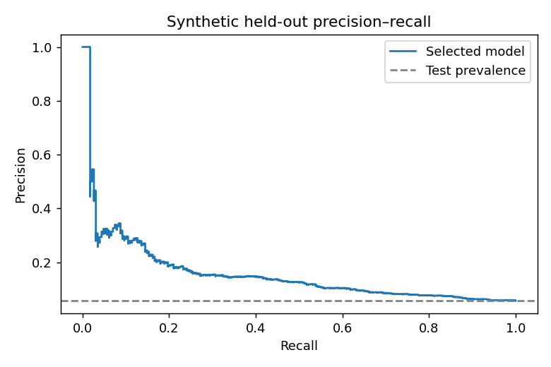
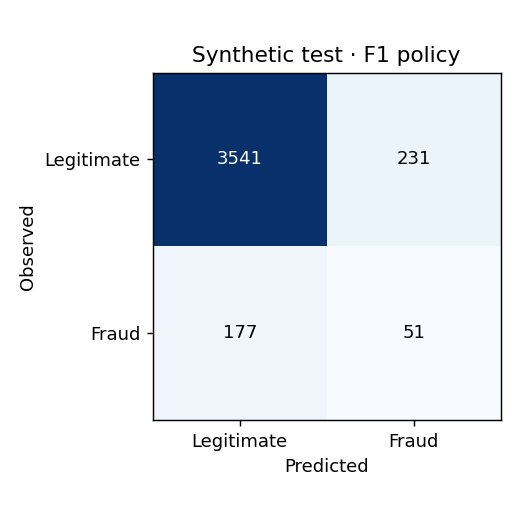

# Synthetic benchmark (historical version 0.2)

**Author:** Rareș Constantinescu

This preserves the version 0.2 synthetic experiment and its measured verification. The current primary experiment is described in the [project README](../README.md) and [real-data report](REAL_DATA.md).

A Python project for studying transaction classification on explicitly synthetic data. The original coursework is preserved alongside a reproducible simulation benchmark with isolated model selection, configurable decision policies, diagnostic reports, and a validated prediction CLI.

## Overview

The original coursework trains a random forest on 1,000 generated transactions. Its 95.2%
test accuracy is reproduced by the generator's single amount boundary. That result is
preserved as historical evidence in the [original audit](AUDIT.md).

The new benchmark demonstrates experimental design and Python engineering on a separate,
versioned simulation. It includes three fixed model candidates, validation-selected decision
thresholds, an untouched final test partition, synthetic stress scenarios, permutation
importance, failure-safe artifacts and a prediction CLI. **It provides no evidence of real
banking fraud detection performance.**

## Problem and dataset

The target is a sampled binary fraud label. The new `iid-context-v1` generator produces
independent transaction contexts with eight observable features: amount, account age, hour,
activity count, distance, foreign-country flag, device and channel. Several weak associations,
interactions and unobserved noise determine label probability. No latent probability, label,
ID or future outcome enters the model.

There are no persistent accounts or meaningful timestamps, so the split is stratified rather
than grouped or chronological. Activity counts are sampled context, not reconstructed
transaction windows. All data are synthetic; no external dataset or customer information is
used. The original and new experiments use different generators and must not be compared as
if their scores measured improvement on the same task. See the [data card](DATA_CARD.md)
for the complete generation equation, schema, seeds and limitations.

## Approach and evaluation

The reference experiment generates 20,000 rows and splits them into 12,000 train, 4,000
validation and 4,000 test rows. Pipelines fit median imputation, numeric scaling, categorical
constant imputation and one-hot encoding on train only. Inference reuses the saved pipeline.
Unknown category strings are accepted; invalid values and unexpected columns are rejected.
No resampling, SMOTE, class weighting or hyperparameter search is used.

Model selection maximizes validation average precision (AP). Threshold selection uses the
same validation partition, so validation estimates are optimistic. `selection.json` is saved
before test scoring. The model is not refitted on train+validation, which preserves the score
scale used for threshold selection. Only the selected model and predefined dummy baseline
are evaluated on the final test. The reported test does not choose new settings.

The four predefined operating points optimize validation F1, a configurable illustrative
error cost, recall under an alert budget, or precision subject to a recall target. Tied scores
are handled as whole groups. An alert budget or recall target met on validation is not a
guarantee on future inputs.

## Measured reference results

Python 3.10.12, seed 2026, generator `iid-context-v1`. The test has **228 fraud labels out of
4,000 rows (5.7%)**. Full values are in [reference_report.json](results/reference_report.json).

| Model | Validation AP | Validation ROC-AUC |
| --- | ---: | ---: |
| Prior-only dummy | 0.0570 | 0.5000 |
| Logistic regression — selected | 0.1650 | 0.7081 |
| Histogram gradient boosting | 0.1454 | 0.7039 |

| Final test configuration | Threshold | Precision | Recall | F1 | Alerts |
| --- | ---: | ---: | ---: | ---: | ---: |
| Dummy, default policy | 0.5000 | 0.0000 | 0.0000 | 0.0000 | 0 / 0% |
| Logistic, default policy | 0.5000 | 0.0000 | 0.0000 | 0.0000 | 0 / 0% |
| Logistic, validation F1 | 0.1269 | 0.1809 | 0.2237 | 0.2000 | 282 / 7.05% |
| Logistic, ≤5% validation alert budget | 0.1627 | 0.2250 | 0.1579 | 0.1856 | 160 / 4.00% |
| Logistic, illustrative cost / high recall | 0.0400 | 0.0811 | 0.7544 | 0.1465 | 2,120 / 53.00% |

Selected-model test AP is **0.1578**, ROC-AUC **0.6872**; dummy AP is **0.0570**. AP is
non-interpolated average precision, not trapezoidal PR-AUC. F1-policy confusion matrix:
`[[3541, 231], [177, 51]]`, with actual classes as rows and predicted classes as columns.

These are modest results: the F1 policy misses 177 of 228 positives, and the default threshold
flags none. The dummy achieves 94.3% accuracy, illustrating why accuracy alone is unhelpful.
The illustrative cost assumes FN=25 and FP=1 arbitrary units; its test cost per transaction
is 0.837 versus 1.425 for the dummy. It flags over half the transactions and is not a practical
operating recommendation. The high-recall policy meets ≥80% recall on validation (81.1%) but
reaches 75.4% on test. Both policies happened to select the same threshold; they remain
separate objectives.




The shuffled-training-label control yields validation AP 0.0588, close to prevalence 0.0570.
Fresh-population tests cover covariate, concept and intercept changes. Paired input tests cover
20% missing cells and unseen device strings. Concept-shift AP falls to 0.0897; missing-cell
AP falls from its paired baseline 0.2015 to 0.1528, while alert volume rises from 7.58% to 14.23%.
These are synthetic diagnostics with frozen settings, not proof of real-world robustness.
Permutation importance is descriptive, especially because some features are correlated.

## Project structure

```text
src/fraud_benchmark/
  data.py          # versioned simulation, validation before splitting, stress inputs
  schema.py        # exact training/scoring input contract
  models.py        # three fixed preprocessing/model pipelines
  evaluation.py    # metrics and exact validation threshold selection
  experiment.py    # selection, frozen evaluation, diagnostics and manifests
  artifacts.py     # trusted model bundles and failure-safe output publication
  cli.py           # generate / run / predict commands
tests/             # deterministic unit, invariant and workflow tests
scripts/audit_original.py
examples/transactions.json
docs/              # audit, data card, engineering review and measured result snapshots
EDA.py, generate_data.py, split_data.py  # preserved original coursework
all_data.csv, train.csv, test.csv, README.pdf, *.txt  # original evidence
```

## Installation

Use Python **3.10–3.12** in a virtual environment. The reference was executed on Python 3.10.12;
CI is configured for 3.10 and 3.12. From a source checkout:

```bash
python3 -m venv .venv
source .venv/bin/activate
python -m pip install -r requirements.lock
python -m pip install --no-deps --no-build-isolation -e .
python -m pip check
```

`requirements.lock` pins the complete tested development dependency set by version.
Installation downloads Python packages; tests and experiments download no datasets.

## Training and evaluation

```bash
fraud-benchmark run --rows 20000 --seed 2026 --output artifacts/reference-2026
```

This generates data, trains the candidates, freezes validation decisions, evaluates the final
test and stress populations, and saves the model, reports, plots, test predictions, partition
membership and SHA-256 manifests. Runs are bounded to 1,000–200,000 rows and numerical
thread pools are limited to one thread. Use a new output directory for another run: existing
directories and files are preserved. The complete reference report was reproduced exactly
in a second run in the same pinned environment.

```bash
fraud-benchmark run --rows 20000 --seed 2026 --fn-cost 10 --fp-cost 1 \
  --alert-budget 0.02 --recall-target 0.9 --output artifacts/alternative-policy
fraud-benchmark generate --rows 1000 --seed 42 --output artifacts/sample.csv
python scripts/audit_original.py
```

Changing cost or alert assumptions defines another experiment; the reference result remains
fixed. `generate` exports a sample for inspection. `run` generates its own dataset from its
configuration. The original audit requires the legacy CSVs in a full repository checkout.
Original scripts overwrite files in their current directory; use the audit's `--run-legacy`
option to reproduce them in a temporary copy.

## Prediction

```bash
fraud-benchmark predict --model artifacts/reference-2026/model.joblib \
  --input examples/transactions.json
fraud-benchmark predict --model artifacts/reference-2026/model.joblib \
  --input examples/transactions.json --threshold 0.16266557937373916 \
  --output artifacts/predictions.json
```

Input is a nonempty JSON array of objects with exactly the eight documented feature keys.
Use `null` for a missing cell; every key is still required in every row. The example includes
a missing distance and an unseen device. Output preserves row order and contains zero-based
`row`, `fraud_score`, `flagged` and `threshold`. Reference scores are approximately 0.0309
(unflagged) and 0.5810 (flagged) at the saved F1 threshold. Scores are not calibrated banking
fraud probabilities. The CLI returns status 2 with a clear error on invalid input or existing
output paths; failed writes do not leave partial CSV or prediction files.

Only load trusted local `joblib` model files: loading can execute Python code. Bundles retain
the pipeline, schema, selected thresholds and exact core dependency versions. Incompatible
bundles are rejected; version checks do not make untrusted pickle data safe.

## Tests and verification

```bash
python -m pytest -q
ruff check src tests scripts
ruff format --check src tests scripts
python -m build --no-isolation
```

All **65 tests passed without warnings**, including a run from the unpacked source archive
against the installed wheel. The suite covers deterministic generation and global-RNG isolation;
schema failures;
duplicate and split invariants; training-only preprocessing; exhaustive threshold objectives
and tied scores; hand-calculated metrics; serialization and score consistency; corrupted
models; output preservation and write failures; complete training/evaluation; and a test-set
mutation check that cannot alter model selection. No network access is used by tests.

GitHub Actions installs the locked environment, runs checks/tests, builds the source archive
and wheel, then installs the wheel and runs training/prediction outside the checkout. Legacy
CSVs and existing model files are unnecessary for the benchmark. Local verification and its
limits are recorded in the [engineering review](ENGINEERING_REVIEW.md).

## Known limitations

- Both generators encode invented associations. No result transfers to real financial fraud.
- One seed and one final holdout give no confidence intervals or repeated-split uncertainty.
- Model and policy selection share validation data; its estimates are optimistic.
- There is no persistent-account simulation, temporal validation or real transaction-history
  feature engineering. Those would require different data and splitting semantics.
- Scores are not independently calibrated. Illustrative costs omit transaction losses,
  intervention effects and operational capacity; validation constraints may fail on new data.
- Missing/unseen categories are accepted consistently, but may substantially change alert volume.
- Dependencies are version-pinned, without package hashes; platform/library differences can
  affect floating-point reproducibility. Model files are intended for the matching environment.

The project is suitable as a **simulation and ML engineering portfolio project with explicit
limitations**. An independent approved public dataset would be a separate future evaluation.
